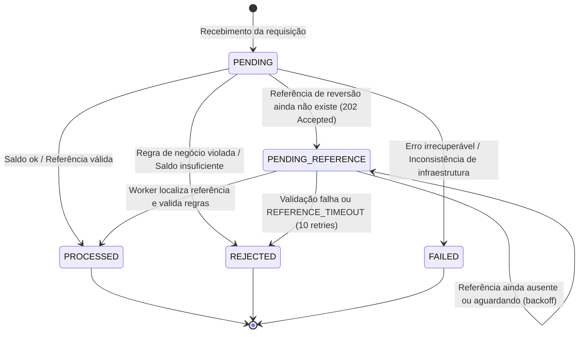

# 🏛️ Decisões Arquiteturais — Distributed Wagering Processor

> Jungle Gaming Technical Challenge

Este documento detalha o desenho técnico, decisões arquiteturais, justificativas e trade-offs do **Distributed Wagering Processor**.

---

## 1. Visão Geral da Arquitetura

O sistema é construído sobre os princípios de **Domain-Driven Design (DDD)** e **Arquitetura Hexagonal (Ports & Adapters)**:

```
                      ┌────────────────────────────────────────┐
                      │             HTTP / SQS FIFO            │
                      └───────────────────┬────────────────────┘
                                          │
                                    Adapters In
                                          ▼
                      ┌────────────────────────────────────────┐
                      │           Application Layer            │
                      │  - ProcessWagerTransactionUseCase      │
                      │  - OpenWalletUseCase                   │
                      │  - ReconcileWalletUseCase              │
                      │  - RetryPendingReferencesUseCase       │
                      └───────────────────┬────────────────────┘
                                          │
                                    Ports / Domain
                                          ▼
                      ┌────────────────────────────────────────┐
                      │              Domain Core               │
                      │  - Money (Value Object Imutável)       │
                      │  - Wallet (Aggregate Root)             │
                      │  - WalletLedgerEntry (Imutável)        │
                      │  - WagerTransaction (State Machine)    │
                      │  - wager-rules (regras da seção 7)     │
                      │  - InboxMessage & OutboxMessage        │
                      │  - IntegrationEvent & Envelope         │
                      └───────────────────┬────────────────────┘
                                          │
                                    Adapters Out
                                          ▼
                      ┌────────────────────────────────────────┐
                      │             Infrastructure             │
                      │  - PostgreSQL 16 (MikroORM)            │
                      │  - AWS SQS FIFO (LocalStack)           │
                      │  - Pino Structured Logger              │
                      └────────────────────────────────────────┘
```

### Bounded Contexts
1. **Wallet Context (`src/wallet/`)**: Responsável pela integridade do saldo e auditoria do livro-razão (ledger). Garante que nenhuma movimentação de saldo ocorra sem um lançamento de contrapartida correspondente.
2. **Wagering Context (`src/wagering/`)**: Gerencia o ciclo de vida das transações de apostas, deduplicação persistente (inbox), resolução de referências (BET, WIN, LOSS, REFUND, ROLLBACK) e publicação atômica de eventos (outbox).

### Portas de Persistência (`UnitOfWork`)
- Os casos de uso dependem apenas de portas: `UnitOfWork` (`src/shared/application/ports/unit-of-work.port.ts`), `WalletRepositoryPort`, `WagerTransactionRepositoryPort` e `WageringMetrics` (telemetria, adaptador Prometheus em `src/shared/infrastructure/metrics/`). Nenhum arquivo de `*/application/` importa `infrastructure/`.
- `UnitOfWork.transactional(work)` abre a transação e entrega um `TransactionScope` com os repositórios ligados a ela. O `lock_timeout` é parâmetro de sessão de cada conexão do pool (enviado ao conectar, em `mikro-orm.config.ts`), sem um comando extra por transação. O adaptador `MikroOrmUnitOfWork` traduz erros do PostgreSQL por **SQLSTATE** para erros tipados da aplicação:

| SQLSTATE / origem | Erro de aplicação | Tratamento no caso de uso |
|---|---|---|
| `23505` + nome da constraint | `UniqueViolationError(constraint)` | `uq_wager_reference_reversal` → `REFERENCE_ALREADY_REVERSED`; `uq_wager_provider_external` → 409; `uq_wager_provider_idempotency_key` → nova tentativa (replay ou 409) |
| `55P03`, `40P01`, `40001`, `OptimisticLockError` | `ConcurrencyConflictError(reason)` | nova tentativa com jitter; esgotadas 6 tentativas → 503 + `Retry-After: 1` |
| classe `08` (conexão), `57P01`–`57P03`, `53300`, `ECONNREFUSED`/`ECONNRESET`…, timeout do pool | `InfrastructureUnavailableError` | sem nova tentativa interna: HTTP 503 + `Retry-After: 1`; no consumer SQS, erro transitório (backoff) |

---

## 2. Escolha do ORM: MikroORM vs TypeORM

**Decisão: MikroORM 6 foi selecionado como ORM oficial.**

### Justificativas:
- **Unit of Work & Identity Map explícitos:** Garante que todas as alterações ocorridas durante uma transação financeira sejam rastreadas de forma coordenada em memória e persistidas em lote (`flush`) em ordem consistente.
- **Versionamento Nativo:** Suporte de primeira classe a versionamento através de `@Property({ version: true })`, gerando `WHERE id = $id AND version = $expectedVersion` — usado como barreira adicional ao lock por linha (seção 3).
- **Transações Confiáveis (`em.transactional()`):** Garante isolamento estrito sem necessidade de manipulação manual de cursores ou `queryRunners` suscetíveis a vazamento de conexões (problema comum no TypeORM).

---

## 3. Estratégia de Concorrência: Lock Pessimista por Wallet + Versão como Barreira

A unidade de concorrência é a **Wallet (`walletId`)**. Decisão e medições em [ADR-001](docs/adr/001-optimistic-locking-strategy.md).

- **Serialização por wallet:** toda transação financeira começa com `SELECT ... FOR UPDATE` na linha da wallet (`WalletRepositoryPort.findByIdForUpdate`). Transações da mesma wallet entram em fila no PostgreSQL; wallets diferentes seguem em paralelo.
- **Ordem única de lock:** a wallet é sempre o primeiro lock adquirido (inclusive pelo worker de referências pendentes), o que elimina deadlocks entre fluxos financeiros.
- **`lock_timeout`:** parâmetro de sessão de cada conexão (padrão `5000ms`, `DB_LOCK_TIMEOUT_MS`; valor inválido é recusado pelo PostgreSQL ao abrir a conexão) limita a espera; o timeout (`55P03`) é tratado como conflito de concorrência e retentado.
- **Versão como barreira:** a coluna `version` continua sendo verificada no `UPDATE`; um conflito de versão também é retentado.
- **Retry limitado:** até 6 tentativas com jitter (`20ms × tentativa` + até `40ms`); esgotadas, HTTP 503 com `Retry-After: 1` (no consumer SQS, backoff via visibilidade da mensagem).
- **Defesa em Profundidade:** `chk_wallets_balance_non_negative CHECK (balance_amount >= 0)` impede saldo negativo no próprio banco.
- **Uma movimentação por wallet por transação SQL:** cada transação financeira altera o saldo de no máximo uma wallet uma vez (regra do enunciado: "no máximo um lançamento por wallet"). O PostgreSQL verifica isso no commit (seção 5).

---

## 4. Separação Estrita: Domínio vs Persistência

- As entidades de domínio (`Wallet`, `WagerTransaction`, `WalletLedgerEntry`, `Money`) são **puras em TypeScript**, livres de decorators de frameworks ou dependências do ORM.
- Construtores são privados com factories estáticas explícitas (`open()`, `create()`, `rehydrate()`).
- As regras de negócio da seção 7 ficam em `src/wagering/domain/wager-rules.ts`, como funções puras sobre os objetos de domínio:
  - `checkReference(tx, referência, jáRevertida)` → `VALID`, `WAIT` (a referência existe mas ainda aguarda) ou `REJECT(failureCode)`;
  - `settle(tx, wallet, referência, instante)` → aplica BET/WIN/LOSS/REFUND/ROLLBACK na wallet ou devolve o `failureCode`;
  - `checkWalletOwnership` → a wallet pertence ao `playerId` e à moeda da operação.
  O caso de uso só orquestra I/O (lock, buscas, persistência, inbox, outbox) em volta delas. Os testes de unidade (`wager-rules.spec.ts`) exercitam esse código de produção diretamente.
- As entidades de persistência (`*MikroEntity`) pertencem exclusivamente à camada de infraestrutura. O repositório realiza o mapeamento bidirecional.

---

## 5. Dinheiro e Precisão Financeira (`Money` VO)

### Restrições Invioláveis Respeitadas:
- **Zero uso de `number`, `float` ou `double`:** Toda aritmética utiliza a biblioteca `decimal.js` com escala fixa de 2 casas decimais.
- **Imutabilidade Estrutural:** Todas as operações aritméticas (`add`, `subtract`, `negate`) retornam uma **nova instância** de `Money`.
- **Persistência Exata:** No PostgreSQL, valores são armazenados como `NUMERIC(19,2)`, impedindo qualquer perda de precisão ou erro de arredondamento.
- **Moeda ISO-4217:** Validação estrita por regex `^[A-Z]{3}$`. Operações entre moedas distintas lançam `CurrencyMismatchError`.

### Reconciliação em Três Vias (`POST /wallets/:id/reconciliation`)
`consistent` só é `true` quando as três fontes concordam:
1. **Saldo × ledger:** `balance_amount` da wallet é igual a `SUM(CREDIT) - SUM(DEBIT)` de `wallet_ledger_entries`.
2. **Ledger × transações:** cada lançamento corresponde a uma transação `PROCESSED` da mesma wallet, com o mesmo valor e moeda e direção compatível com o tipo (BET → DEBIT; WIN, REFUND, OPENING → CREDIT; LOSS nunca gera lançamento).
3. **Transações × ledger:** toda transação `PROCESSED` que movimenta saldo (todas exceto LOSS) tem lançamento.

As três checagens também são **impostas pelo PostgreSQL no commit** (gatilhos de restrição diferidos), então uma divergência não chega a ser gravada pela aplicação:

| Gatilho | Garante |
|---|---|
| `trg_ledger_matches_transaction` | lançamento ↔ transação `PROCESSED` da mesma wallet, mesmo valor, moeda e direção compatível |
| `trg_processed_transaction_has_ledger` | transação `PROCESSED` que movimenta saldo tem lançamento |
| `trg_wallet_balance_has_ledger` | wallet criada na versão 1 (saldo inicial positivo tem o lançamento de abertura); **toda alteração de saldo** leva a versão a exatamente `versão + 1` e tem o lançamento `(versão nova, saldo antigo → saldo novo)`; sem alteração de saldo a versão não muda |
| `trg_ledger_wallet_version` | **todo lançamento** é o estado da wallet no commit (mesma versão, mesmo `balance_after`, mesma moeda): não existe lançamento sem a movimentação que ele descreve |

Cada lançamento grava `wallet_version`, a versão da wallet que ele produziu (`UNIQUE (wallet_id, wallet_version)`). Com os dois últimos gatilhos, o ledger de cada wallet é uma cadeia sem lacunas (`balance_before` de um lançamento = `balance_after` do anterior) cujo último `balance_after` é o saldo armazenado: **`wallet.balance == saldo reconstruído pelo ledger` é garantido pelo banco**, não só verificado. A mesma sequência dá ao ledger uma ordem total por wallet, usada no cursor de paginação (seção 12).

A reconciliação continua verificando (campos `difference` e `transactionMismatches`) porque escritas privilegiadas que desligam gatilhos (`session_replication_role = replica`, restauração de backup, correção manual) ainda são possíveis. Divergências **não são corrigidas**: são logadas (`RECONCILIATION_DISCREPANCY`), contadas em `wagering_reconciliation_discrepancies_total` e devolvidas com `consistent: false`. Custo medido dos gatilhos de transação: 5–8% no p99 do teste de carga no processo.

---

## 6. Idempotência Persistente e Algoritmo de Hashing Canônico

### Idempotency-Key
- O header HTTP `Idempotency-Key` é **obrigatório** e é a fonte da verdade (padrão recomendado: `"{providerId}:{externalTransactionId}"`). Ausente ou em branco → `400 MISSING_IDEMPOTENCY_KEY`; mais de 512 caracteres → `400 INVALID_IDEMPOTENCY_KEY`. Na fila, o campo equivalente é `data.idempotencyKey` (obrigatório no contrato).
- É único **por provedor**: `UNIQUE (provider_id, idempotency_key)`. Cada provedor escolhe as próprias chaves; um provedor não ocupa, não reproduz e não conflita com a chave de outro.
- `playerId` e `walletId` são normalizados para minúsculas na entrada do caso de uso (o PostgreSQL devolve UUIDs em minúsculas), então a mesma requisição em caixa diferente é um replay, não um conflito.

### Algoritmo de Payload Hash
Para distinguir um **replay legítimo** de um **conflito de payload** sob a mesma chave:
1. Filtra-se o subconjunto de negócio canônico:
   `{ providerId, externalTransactionId, playerId, walletId, roundId, gameId, kind, money: { amount, currency }, referenceExternalTransactionId }`. Metadados de transporte e headers ficam de fora.
2. Serializa-se recursivamente com chaves ordenadas lexicograficamente (`canonicalizeJson`).
3. Calcula-se o hash **SHA-256** do JSON canônico.

### Comportamento:
- **Mesma chave + mesmo hash:** Retorna o resultado original sem reexecutar movimentação financeira (`idempotentReplay: true`).
- **Mesma chave + hash diferente:** Rejeição imediata com `HTTP 409 Conflict` (`IDEMPOTENCY_CONFLICT`) — **em qualquer estado da transação existente, inclusive `PENDING_REFERENCE`**.
- **Retomada de `PENDING_REFERENCE`:** valor movimentado e referência buscada vêm sempre da transação persistida, nunca do comando reenviado.
- **Reenvio idêntico de uma transação que ainda aguarda a referência:** se a referência continua ausente (ou ela mesma aguardando), a resposta é a original (`202`, `PENDING_REFERENCE`, `idempotentReplay: true`) e nada muda: nenhum evento novo, nenhuma tentativa do worker consumida. Se a referência já chegou, o reenvio resolve a transação na hora.

### Validação de Contrato
HTTP e SQS usam o mesmo validador (`src/wagering/application/wager-payload.validator.ts`), alinhado ao schema: `kind` em `BET|WIN|LOSS|REFUND|ROLLBACK`; valor decimal com exatamente 2 casas, cabendo em `NUMERIC(19,2)` e maior que zero (exceto LOSS); moeda ISO-4217; `playerId`/`walletId` UUID; `roundId`/`gameId` obrigatórios; limites de tamanho das colunas; referência obrigatória para REFUND/ROLLBACK. Violação → HTTP 400 `INVALID_PAYLOAD` com a lista de problemas, ou DLQ com `FailureReason=INVALID_CONTRACT`.

Os demais endpoints também validam a borda: `POST /wallets` (playerId UUID, `initialBalance` com 2 casas e moeda ISO) → `400 INVALID_PAYLOAD`; identificadores de rota que não são UUID → `400 INVALID_ID`; `limit` fora de 1–200 → `400 INVALID_LIMIT`; cursor adulterado → `400 INVALID_CURSOR`. Nenhum valor fora do contrato chega ao PostgreSQL para virar 500.

### Titularidade da wallet
A wallet precisa pertencer ao `playerId` informado pelo provedor e estar na moeda da operação. Caso contrário a transação é `REJECTED` com `WALLET_PLAYER_MISMATCH` ou `CURRENCY_MISMATCH` (422, auditável, sem movimentar saldo). Sem isso, um provedor poderia debitar a wallet de outro jogador só conhecendo o `walletId`.

---

## 7. Transactional Outbox Pattern e Ordem por Wallet

Garantia de que eventos de integração **nunca são perdidos, nunca são publicados antes do commit e saem em ordem por wallet**. Decisão em [ADR-005](docs/adr/005-outbox-per-group-ordering.md).

1. A movimentação da wallet, lançamento no ledger, registro na inbox e inserção na tabela `outbox_messages` ocorrem **na mesma transação SQL**.
2. `outbox_messages.message_group_id` é uma coluna gerada (`data.walletId`, senão `aggregate_id`) e é também o `MessageGroupId` enviado ao SQS FIFO.
3. A cada ciclo, o `OutboxPublisherWorker` seleciona os grupos cuja mensagem **mais antiga** não publicada já está liberada (fora de backoff).
4. Para cada grupo, tenta `pg_try_advisory_xact_lock(hashtextextended('outbox:' || grupo, 0))`. Se outro publisher detém o grupo, o grupo é pulado nesse ciclo; assim cada wallet é publicada por **um publisher por vez**, com várias instâncias em paralelo em grupos diferentes.
5. As mensagens do grupo são publicadas em ordem `(occurred_at, id)` e a publicação **para na primeira mensagem em backoff ou com falha**: um evento posterior nunca ultrapassa um anterior. Grupos diferentes (até 8) são publicados em paralelo, e o publisher repete o ciclo imediatamente enquanto houver trabalho (espera 1 s só quando o outbox está vazio).
6. Somente após a confirmação do envio ao SQS a mensagem é marcada com `published_at`.
7. Falha temporária do SQS agenda nova tentativa com **backoff exponencial** (`2s`, `4s`, `8s`... até `60s`).

---

## 8. Mensageria SQS FIFO e Deduplicação Inbox

- **Filas FIFO:** `wager-transactions.fifo` com `ContentBasedDeduplication`, `MessageGroupId = walletId` e `RedrivePolicy` com `maxReceiveCount: 15` (rede de segurança acima dos limites da aplicação).
- **Inbox Pattern:** Tabela `inbox_messages` com chave primária composta `(consumer_name, message_id)`.
- **Ack Somente Após Commit:** `DeleteMessage` é emitido exclusivamente após o commit com sucesso da transação no PostgreSQL.
- **Ordem dentro do lote:** se uma mensagem de um grupo falha e permanece na fila, as mensagens seguintes do **mesmo grupo** no mesmo lote não são processadas; voltam à fila (visibilidade 0) atrás dela. Outros grupos seguem normalmente.
- **Classificação de erros:**

| Erro | Destino |
|---|---|
| JSON inválido, contrato inválido | DLQ imediata (`MALFORMED_JSON`, `INVALID_CONTRACT`) |
| Erro de domínio, HTTP 4xx (wallet inexistente, colisão de ID externo, conflito de idempotência) | DLQ imediata (`<código>` ou `HTTP_<status>`) |
| Erro transitório | backoff `min(5 × 2^receiveCount, 300)`s; DLQ + `FAILED` ao atingir 5 recebimentos |
| Contenção de lock / 503 | mesmo backoff; DLQ + `FAILED` ao atingir 10 recebimentos |

- **DLQ sem perda:** a mensagem só é apagada da fila principal depois que a DLQ aceitou a cópia; se o envio à DLQ falhar, a mensagem permanece na fila e é retentada. Cada mensagem na DLQ leva o atributo `FailureReason`.
- **Redrive da DLQ:** `bun run dlq:redrive --reason <FailureReason> [--execute]` (dry-run por padrão) devolve à fila principal apenas os motivos escolhidos, apagando da DLQ só após a fila principal confirmar. Mensagens com `MAX_*_RECEIVES` já têm a transação em `FAILED` (terminal) e não devem ser reenviadas.
- **Retenção:** o `RetentionWorker` (de hora em hora) remove em lotes curtos mensagens do outbox publicadas há mais de `OUTBOX_RETENTION_DAYS` (padrão 7) e registros do inbox processados há mais de `INBOX_RETENTION_DAYS` (padrão 30, mínimo 15: o inbox precisa sobreviver à retenção máxima do SQS, 14 dias, para continuar deduplicando reentregas). Nunca remove mensagem não publicada nem registro não processado.
- **Graceful Shutdown:** em `SIGTERM`/`SIGINT`, o consumidor para de buscar mensagens, devolve as não iniciadas do lote (visibilidade 0) e aguarda as em processamento; o processo encerra explicitamente com `process.exit(0)` após `app.close()`, pois como PID 1 em container um sinal re-emitido seria ignorado.

---

## 9. Referências Fora de Ordem (Pending Reference)

Quando uma operação de reversão (`REFUND` ou `ROLLBACK`) é entregue antes da transação que ela referencia:
1. O sistema persiste a transação com status **`PENDING_REFERENCE`** e status HTTP **`202 Accepted`**.
2. Emite o evento `WagerTransactionPendingReference`.
3. O worker agendado `PendingReferenceWorker` reprocessa transações pendentes utilizando **backoff exponencial** (`min(1s * 2^retry, 300s)`). Cada pendência é resolvida **na própria transação**: o worker trava a wallet primeiro, relê a pendência (se outra instância já a resolveu, segue adiante) e reaplica o payload persistido. Uma falha em uma pendência não desfaz as demais.
4. **Cadeias fora de ordem:** se a referência **existe mas ela mesma aguarda** (`PENDING_REFERENCE`), a reversão continua aguardando em vez de ser rejeitada. Exemplo: `ROLLBACK(REFUND)` → `REFUND(BET)` → `BET` chegando nessa ordem terminam os três `PROCESSED`. Divergências de contexto (provedor, jogador, wallet, rodada, moeda, valor, tipo) são rejeitadas na hora, mesmo com a referência aguardando, porque nunca vão se tornar válidas. Referência terminal `REJECTED`/`FAILED` → `REFERENCE_NOT_PROCESSED`.
5. **TTL / Limite:** Após 10 tentativas sem que a referência surja (≈ 20 minutos com o backoff acima), a transação transiciona para **`REJECTED`** com o código **`REFERENCE_TIMEOUT`**, emitindo o evento `WagerTransactionRejected`. O limite equilibra provedores que reenviam a aposta original com atraso de minutos e o custo de manter pendências abertas.

### Interpretação adotada: uma reversão por referência
O enunciado diz que "uma referência não pode ser revertida duas vezes pelo mesmo tipo de operação". A implementação é mais estrita: uma transação só pode ter **uma** reversão `PROCESSED`, de qualquer tipo (`uq_wager_reference_reversal` em `reference_transaction_id`). Motivo: `REFUND(BET)` seguido de `ROLLBACK(BET)` devolveria o mesmo valor duas vezes. Desfazer um REFUND continua possível referenciando o próprio REFUND (`ROLLBACK(REFUND)`). Detalhes no [ADR-003](docs/adr/003-reversal-unique-index-semantics.md).

---

## 10. Máquina de Estados da Transação de Aposta

O ciclo de vida de uma transação de aposta (`WagerTransaction`) obedece à máquina de estados estrita abaixo:



### Regras de Transição e Invariantes:
- **Estados Terminais:** `PROCESSED`, `REJECTED`, `FAILED`. Nenhuma transição é permitida a partir destes estados: no domínio (`InvalidTransactionStateError`, erro de programação) e no banco (`trg_wager_transaction_guard`: linha terminal não muda, colunas de negócio — provedor, IDs, wallet, jogador, rodada, tipo, valor, moeda, referência — nunca mudam, nenhuma linha volta a `PENDING`, e transações nunca são apagadas; `TRUNCATE` de `wager_transactions` e `wallet_ledger_entries` também é bloqueado).
- **Replay Idempotente:** Uma transação em qualquer estado terminal ou em `PENDING_REFERENCE` retorna sua resposta original em replays idempotentes com o mesmo payload hash, preservando o `balanceAfter` histórico capturado no momento do processamento.
- **Atômico:** A mudança para `PROCESSED` sempre ocorre na mesma transação de banco com a atualização da wallet, lançamento do ledger imutável e inserção do evento correspondente na outbox.

---

## 11. Taxonomia de Falhas (`FailureCode`)

Toda rejeição grava um `failureCode` estável (`src/shared/domain/errors/failure-codes.ts`), devolvido na resposta e no evento `WagerTransactionRejected`. A última coluna é o que o provedor deve fazer.

| FailureCode | Status | Causa | Ação do provedor |
|---|---|---|---|
| `INSUFFICIENT_BALANCE` | `422` `REJECTED` | BET maior que o saldo | Desistir (ou nova aposta com outro valor e outra chave) |
| `REVERSAL_INSUFFICIENT_BALANCE` | `422` `REJECTED` | ROLLBACK de WIN/REFUND deixaria saldo negativo (distinto de aposta sem saldo, regra 9) | Escalar para operação; não reenviar |
| `CURRENCY_MISMATCH` | `422` `REJECTED` | Moeda diferente da wallet ou da referência | Corrigir payload, nova chave |
| `WALLET_PLAYER_MISMATCH` | `422` `REJECTED` | A wallet não pertence ao `playerId` informado | Corrigir payload, nova chave |
| `CROSS_PROVIDER_REFERENCE` / `CROSS_PLAYER_REFERENCE` / `CROSS_WALLET_REFERENCE` / `CROSS_ROUND_REFERENCE` | `422` `REJECTED` | Referência de outro provedor, jogador, wallet ou rodada | Corrigir referência, nova chave |
| `REVERSAL_AMOUNT_MISMATCH` | `422` `REJECTED` | Valor diferente do da referência (reversão parcial fora de escopo) | Corrigir valor, nova chave |
| `INVALID_REFERENCE_KIND` | `422` `REJECTED` | REFUND de algo que não é BET; ROLLBACK de LOSS/ROLLBACK | Corrigir referência |
| `REFERENCE_ALREADY_REVERSED` | `422` `REJECTED` | A referência já tem uma reversão `PROCESSED` | Desistir (já revertida) |
| `REFERENCE_NOT_PROCESSED` | `422` `REJECTED` | A referência existe mas terminou `REJECTED`/`FAILED` | Desistir |
| `REFERENCE_TIMEOUT` | `REJECTED` (evento) | Referência não chegou em 10 tentativas do worker | Enviar a referência e a reversão de novo, com nova chave |
| `PERMANENT_PROCESSING_ERROR` | `500` `FAILED` | Erro não recuperável no consumer (tentativas esgotadas); mensagem na DLQ | Escalar para operação; o reenvio com a mesma chave devolve o mesmo `FAILED` |

Erros de contrato e de transporte não viram transação (nada é gravado) e têm código próprio no corpo: `INVALID_PAYLOAD`, `MISSING_IDEMPOTENCY_KEY`, `INVALID_IDEMPOTENCY_KEY`, `INVALID_ID`, `INVALID_LIMIT`, `INVALID_CURSOR` (400); `IDEMPOTENCY_CONFLICT`, `WALLET_ALREADY_EXISTS`, colisão de `(providerId, externalTransactionId)` sob outra chave (409); `CONCURRENCY_LIMIT_EXCEEDED`, `SERVICE_UNAVAILABLE` (503).

---

## 12. Mapeamento de Status HTTP

Mesmo critério em todos os endpoints: o status diz ao provedor se ele pode reenviar.

| Situação | Status | Corpo / observações | Reenviar? |
|---|---|---|---|
| Transação aplicada | `200 OK` | `status: "PROCESSED"`, `balance` após a operação | — |
| Wallet criada | `201 Created` | saldo inicial, `version: 1` | — |
| Aceita, aguardando referência | `202 Accepted` | `status: "PENDING_REFERENCE"` | Pode reenviar (replay) |
| Payload ou header inválido | `400 Bad Request` | `INVALID_PAYLOAD`, `MISSING_IDEMPOTENCY_KEY`, `INVALID_IDEMPOTENCY_KEY`, `INVALID_ID`, `INVALID_LIMIT`, `INVALID_CURSOR` | Só depois de corrigir |
| Wallet ou transação inexistente | `404 Not Found` | — | Não |
| Conflito | `409 Conflict` | `IDEMPOTENCY_CONFLICT` (mesma chave, payload diferente); `(providerId, externalTransactionId)` já usado com outra chave; `WALLET_ALREADY_EXISTS` | Não (com outra chave, se for nova operação) |
| Regra de negócio violada | `422 Unprocessable Entity` | `status: "REJECTED"` + `failureCode` (seção 11); terminal | Não |
| Falha permanente registrada | `500 Internal Server Error` | `status: "FAILED"` + `failureCode`; terminal | Não (escalar) |
| Falha transitória | `503 Service Unavailable` + `Retry-After: 1` | `CONCURRENCY_LIMIT_EXCEEDED` (contenção após 6 tentativas) ou `SERVICE_UNAVAILABLE` (PostgreSQL inalcançável) | Sim, com a mesma chave |

**Replays** mantêm o status do resultado original (200, 202, 422 ou 500) com `idempotentReplay: true` e o saldo observado na época. Um erro inesperado (bug) responde `500` sem `status` no corpo, sem detalhes internos, e é logado com o `correlationId`.

**Ledger:** `GET /wallets/:id/ledger?limit=50&cursor=...` devolve os lançamentos do mais novo para o mais antigo. O cursor é opaco (`base64url("v1:<walletVersion>")`) e estável: como `wallet_version` é única e sem lacunas por wallet, as páginas nunca pulam nem repetem lançamentos, mesmo com movimentações novas entre as chamadas (elas aparecem só numa nova primeira página).

---

## 13. Registro de Decisões e Migrações (ADR / Migrations Registry)

Todas as alterações estruturais são versionadas como migrações bidirecionais (`up` e `down`):

1. **`Migration20260101000001_initial_schema.ts`**:
   - Criação das tabelas fundamentais: `wallets`, `wallet_ledger_entries`, `wager_transactions`, `inbox_messages`, `outbox_messages`.
   - Constraints invioláveis de saldo não-negativo (`balance_amount >= 0`) e chaves únicas de idempotência.
2. **`Migration20261011000001_ledger_immutability.ts` (P0.1)**:
   - Gatilho (`BEFORE UPDATE OR DELETE ON wallet_ledger_entries`) impedindo fisicamente qualquer mutação ou exclusão de lançamentos contábeis a nível de engine do PostgreSQL.
3. **`Migration20261011000002_reversal_unique_index.ts` (P0.2)**:
   - Criação do índice parcial único `uq_wager_reference_reversal` em `(reference_transaction_id, kind)` para reversões `PROCESSED` (substituído pela migration 5).
4. **`Migration20261011000003_wager_balance_after.ts` (P0.3)**:
   - Adiciona a coluna `balance_after NUMERIC(19,2)` à tabela `wager_transactions`.
   - Permite que replays idempotentes devolvam o saldo exato observado no instante da transação original, sem recalcular ou vazar o saldo atual modificado por transações posteriores.
5. **`Migration20261011000004_strict_single_reversal_index.ts`**:
   - Recria `uq_wager_reference_reversal` apenas em `(reference_transaction_id)` com `status = 'PROCESSED'`: no máximo uma reversão processada por transação de referência, independentemente do tipo (REFUND ou ROLLBACK).
6. **`Migration20261012000001_outbox_message_group.ts`**:
   - Adiciona a coluna gerada `outbox_messages.message_group_id` e o índice parcial `idx_outbox_group_unpublished` para a publicação ordenada por wallet (seção 7).
7. **`Migration20261012000002_retention_indexes.ts`**:
   - Índices parciais `idx_outbox_published_at` e `idx_inbox_processed_at` para o expurgo por idade sem varrer as tabelas (seção 8).
8. **`Migration20261012000003_provider_scoped_idempotency.ts`**:
   - Troca `uq_wager_idempotency_key (idempotency_key)` por `uq_wager_provider_idempotency_key (provider_id, idempotency_key)`.
9. **`Migration20261012000004_ledger_transaction_integrity.ts`**:
   - Gatilhos de restrição diferidos: todo lançamento corresponde a uma transação `PROCESSED` da mesma wallet, com mesmo valor, moeda e direção compatível; toda transação `PROCESSED` que movimenta saldo tem lançamento.
10. **`Migration20261012000005_wager_wallet_index.ts`**:
   - Índice `idx_wager_transactions_wallet`: a chave estrangeira `wallet_id` não tinha índice e as consultas por wallet (reconciliação) varriam a tabela inteira.
11. **`Migration20261015000001_wager_transaction_guard.ts`**:
   - `trg_wager_transaction_guard`: transação terminal imutável, colunas de negócio imutáveis, sem volta a `PENDING`, sem `DELETE`; `TRUNCATE` bloqueado em `wager_transactions` e `wallet_ledger_entries` (seção 10).
12. **`Migration20261015000002_ledger_wallet_version_chain.ts`**:
   - Coluna `wallet_ledger_entries.wallet_version` (backfill a partir da versão atual de cada wallet), `uq_ledger_wallet_version`, `chk_ledger_wallet_version_positive` e os gatilhos diferidos `trg_wallet_balance_has_ledger` e `trg_ledger_wallet_version` (seção 5). Decisão em [ADR-006](docs/adr/006-balance-ledger-pairing-in-schema.md).

---

## 14. Observabilidade e Métricas Prometheus (`/metrics`)

O sistema expõe um endpoint `/metrics` no formato texto do Prometheus (através de `prom-client`), permitindo telemetria em tempo real das operações financeiras:

- **Métricas Padrão do Node.js:** Ciclos de Garbage Collection, consumo de heap/RSS, event loop lag e descritores de arquivo.
- **`wagering_transactions_total{kind, status}`:** Transações por status resultante (`PROCESSED`, `REJECTED`, `PENDING_REFERENCE`, `FAILED`), sem contar replays.
- **`wagering_transactions_processed_total{kind}`:** Contador de transações finalizadas com sucesso por tipo (`BET`, `WIN`, `LOSS`, `REFUND`, `ROLLBACK`).
- **`wagering_transactions_rejected_total{kind, failure_code}`:** Contador de transações rejeitadas por tipo e código de erro de negócio.
- **`wagering_transactions_failed_total{kind}`:** Contador de transações que transicionaram para `FAILED` por erros de infraestrutura ou sistema.
- **`wagering_idempotent_replays_total{kind}`:** Contador de replays absorvidos com sucesso pela camada de idempotência sem reexecução contábil.
- **`wagering_transaction_processing_duration_ms{kind, outcome}`:** Histograma de latência end-to-end do processamento da aposta.
- **`wagering_pending_references_current`:** Gauge do total atual de transações aguardando a chegada da referência.
- **`wagering_outbox_pending_messages`:** Gauge do backlog de mensagens pendentes de publicação no broker SQS.
- **`wagering_outbox_lag_seconds`:** Gauge da idade da mensagem não publicada mais antiga.
- **`wagering_pending_references_resolved_total`** e **`wagering_reconciliation_discrepancies_total`:** contadores atualizados pelo worker de pendências e pela reconciliação.
- **`wagering_optimistic_lock_conflicts_total`**, **`wagering_retry_attempts_total{type}`** e **`wagering_dlq_messages_total`:** contenção, retentativas e mensagens enviadas à DLQ.

Correspondência com o mínimo pedido no enunciado: transações por status → `wagering_transactions_total`; duplicatas detectadas → `wagering_idempotent_replays_total`; retries → `wagering_retry_attempts_total`; mensagens em DLQ → `wagering_dlq_messages_total`; conflitos de lock → `wagering_optimistic_lock_conflicts_total` (conta também lock timeout e deadlock); outbox lag → `wagering_outbox_lag_seconds`; latência → `wagering_transaction_processing_duration_ms`.

### Logs estruturados
- JSON (Pino) em produção; em desenvolvimento, `pino-pretty`.
- Todo log de negócio é um objeto com os identificadores da operação: `correlationId`, `messageId` (SQS), `transactionId`, `walletId`, `providerId`, `externalTransactionId`, `kind`, `status`, `failureCode`, `idempotentReplay`, `durationMs`.
- **Nunca** entram valores, saldos ou payloads completos (exceção: a diferença da reconciliação, que é o próprio diagnóstico).
- **`correlationId`:**
  - HTTP: o header `X-Correlation-Id` do chamador (se bem formado) ou um UUID novo. Ele é devolvido no header da resposta, usado como id da requisição no log de acesso e propagado ao caso de uso e aos eventos da outbox.
  - SQS: `correlationId` do envelope ou, na falta dele, o `messageId`, que também vira `causationId` dos eventos.
- O log de acesso HTTP só registra falhas (4xx em `warn`, 5xx em `error`). Cada transação gera uma linha `wager transaction <resultado>` em `info` (`warn` para rejeições). Em carga muito alta, `LOG_LEVEL=warn` mantém só os desvios.

### Alertas
`infra/prometheus/alerts.yml` define 8 regras (divergência de reconciliação, transações FAILED, mensagens na DLQ, lag do outbox, pendências acumuladas, contenção esgotada/503, latência p95 e instância fora do ar). O CI valida a sintaxe (`promtool check rules`) e testa o disparo de regras com séries sintéticas (`promtool test rules`, `alerts.test.yml`).

---

## 15. Autenticação e Ponto de Extensão

Conforme seção 2 do desafio técnico:
- Implementou-se o **`NoopAuthGuard`** e a interface **`ProviderIdentityPort`** como pontos de extensão explícitos.
- **Desenho para Produção:** Integração com Keycloak ou Zitadel via OpenID Connect (OIDC). O Guard validará o JWT Bearer Token emitido pelo IdP, extraindo `providerId` e `roles` dos claims do token.
- Endpoints de health (`/health/live`, `/health/ready`), métricas (`/metrics`) e canais internos de fila permanecem desprovidos de autenticação externa por design.

---

## 16. Limitações Conhecidas e Escopo Técnico

Para manter a clareza e o alinhamento com os limites de um desafio técnico focado em processamento distribuído:

1. **Coordenação Distribuída Multi-Região (Active-Active):** A arquitetura atual utiliza PostgreSQL como fonte soberana de verdade com lock por linha da wallet e sequencialidade garantida por transações ACID. Uma expansão multi-região exigiria sharding geográfico por jurisdição/jogador ou bancos Spanner/CockroachDB.
2. **SAGA / Compensação Distribuída Trans-Provedor:** O ciclo atual suporta reversões locais atômicas (`ROLLBACK` e `REFUND`). Em cenários onde um provedor terceiro requer compensações distribuídas em duas fases (2PC/SAGA orchestration) entre diferentes plataformas de jogos, orquestradores de fluxo (ex: Temporal ou Camunda) seriam recomendados.
3. **Distributed Tracing (W3C TraceContext):** Embora os logs estruturados via Pino incluam `correlationId` em cada requisição e evento da outbox, a propagação completa de spans OpenTelemetry com Jaeger/OTel Collector não foi incorporada para evitar dependências adicionais desnecessárias nesta fase.
4. **Uma movimentação por wallet por transação SQL:** os gatilhos de pareamento saldo ↔ ledger exigem que cada transação SQL mova o saldo de uma wallet no máximo uma vez (o lançamento precisa ser o estado final da wallet no commit). É o desenho atual de todos os fluxos; operações em lote na mesma wallet precisariam de uma transação por movimentação.
5. **Escritas privilegiadas:** um superusuário pode desligar gatilhos (`session_replication_role = replica`). Por isso a reconciliação continua existindo e alertando (`ReconciliationDiscrepancy`).
6. **Reversão parcial e multi-moeda:** reversões exigem o valor exato da referência (parcial fora de escopo, como no enunciado). O modelo é multi-moeda (uma wallet por `playerId + currency`), mas os testes de carga usam só `BRL`.
