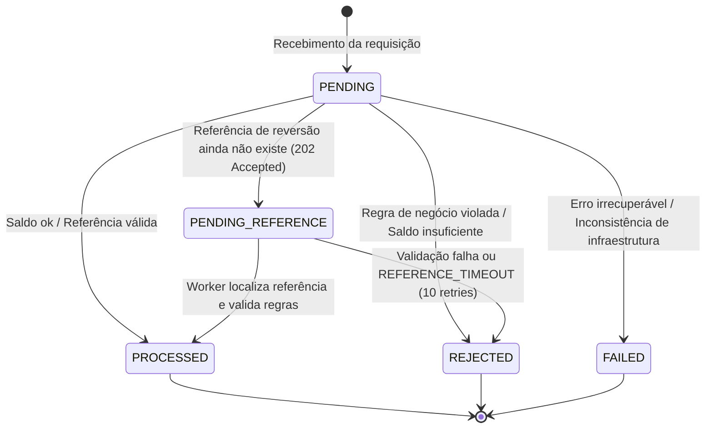

# 🏛️ Decisões Arquiteturais — Distributed Wagering Processor

> Jungle Gaming Technical Challenge

Este documento detalha o desenho técnico, decisões arquiteturais, justificativas e trade-offs do **Distributed Wagering Processor**.

---

## 1. Visão Geral da Arquitetura

O sistema é construído sobre os princípios de **Domain-Driven Design (DDD)** e **Arquitetura Hexagonal (Ports & Adapters)**:

```
                      ┌────────────────────────────────────────┐
                      │             HTTP / SQS FIFO            │
                      └───────────────────┬────────────────────┘
                                          │
                                    Adapters In
                                          ▼
                      ┌────────────────────────────────────────┐
                      │           Application Layer            │
                      │  - ProcessWagerTransactionUseCase      │
                      │  - OpenWalletUseCase                   │
                      │  - ReconcileWalletUseCase              │
                      │  - RetryPendingReferencesUseCase       │
                      └───────────────────┬────────────────────┘
                                          │
                                    Ports / Domain
                                          ▼
                      ┌────────────────────────────────────────┐
                      │              Domain Core               │
                      │  - Money (Value Object Imutável)       │
                      │  - Wallet (Aggregate Root)             │
                      │  - WalletLedgerEntry (Imutável)        │
                      │  - WagerTransaction (State Machine)    │
                      │  - InboxMessage & OutboxMessage        │
                      │  - IntegrationEvent & Envelope         │
                      └───────────────────┬────────────────────┘
                                          │
                                    Adapters Out
                                          ▼
                      ┌────────────────────────────────────────┐
                      │             Infrastructure             │
                      │  - PostgreSQL 16 (MikroORM)            │
                      │  - AWS SQS FIFO (LocalStack)           │
                      │  - Pino Structured Logger              │
                      └────────────────────────────────────────┘
```

### Bounded Contexts
1. **Wallet Context (`src/wallet/`)**: Responsável pela integridade do saldo e auditoria do livro-razão (ledger). Garante que nenhuma movimentação de saldo ocorra sem um lançamento de contrapartida correspondente.
2. **Wagering Context (`src/wagering/`)**: Gerencia o ciclo de vida das transações de apostas, deduplicação persistente (inbox), resolução de referências (BET, WIN, LOSS, REFUND, ROLLBACK) e publicação atômica de eventos (outbox).

### Portas de Persistência (`UnitOfWork`)
- Os casos de uso dependem apenas de portas: `UnitOfWork` (`src/shared/application/ports/unit-of-work.port.ts`), `WalletRepositoryPort`, `WagerTransactionRepositoryPort` e `WageringMetrics` (telemetria, adaptador Prometheus em `src/shared/infrastructure/metrics/`). Nenhum arquivo de `*/application/` importa `infrastructure/`.
- `UnitOfWork.transactional(work)` abre a transação e entrega um `TransactionScope` com os repositórios ligados a ela. O adaptador `MikroOrmUnitOfWork` aplica `SET LOCAL lock_timeout` (valor validado) e traduz erros do PostgreSQL por **SQLSTATE** para erros tipados da aplicação:

| SQLSTATE / origem | Erro de aplicação | Tratamento no caso de uso |
|---|---|---|
| `23505` + nome da constraint | `UniqueViolationError(constraint)` | `uq_wager_reference_reversal` → `REFERENCE_ALREADY_REVERSED`; `uq_wager_provider_external` → 409; `uq_wager_idempotency_key` → nova tentativa (replay ou 409) |
| `55P03`, `40P01`, `40001`, `OptimisticLockError` | `ConcurrencyConflictError(reason)` | nova tentativa com jitter; esgotadas 6 tentativas → 503 + `Retry-After: 1` |

---

## 2. Escolha do ORM: MikroORM vs TypeORM

**Decisão: MikroORM 6 foi selecionado como ORM oficial.**

### Justificativas:
- **Unit of Work & Identity Map explícitos:** Garante que todas as alterações ocorridas durante uma transação financeira sejam rastreadas de forma coordenada em memória e persistidas em lote (`flush`) em ordem consistente.
- **Versionamento Nativo:** Suporte de primeira classe a versionamento através de `@Property({ version: true })`, gerando `WHERE id = $id AND version = $expectedVersion` — usado como barreira adicional ao lock por linha (seção 3).
- **Transações Confiáveis (`em.transactional()`):** Garante isolamento estrito sem necessidade de manipulação manual de cursores ou `queryRunners` suscetíveis a vazamento de conexões (problema comum no TypeORM).

---

## 3. Estratégia de Concorrência: Lock Pessimista por Wallet + Versão como Barreira

A unidade de concorrência é a **Wallet (`walletId`)**. Decisão e medições em [ADR-001](docs/adr/001-optimistic-locking-strategy.md).

- **Serialização por wallet:** toda transação financeira começa com `SELECT ... FOR UPDATE` na linha da wallet (`WalletRepositoryPort.findByIdForUpdate`). Transações da mesma wallet entram em fila no PostgreSQL; wallets diferentes seguem em paralelo.
- **Ordem única de lock:** a wallet é sempre o primeiro lock adquirido (inclusive pelo worker de referências pendentes), o que elimina deadlocks entre fluxos financeiros.
- **`lock_timeout`:** `SET LOCAL lock_timeout` (padrão `5000ms`, `DB_LOCK_TIMEOUT_MS`) limita a espera; o timeout (`55P03`) é tratado como conflito de concorrência e retentado.
- **Versão como barreira:** a coluna `version` continua sendo verificada no `UPDATE`; um conflito de versão também é retentado.
- **Retry limitado:** até 6 tentativas com jitter (`20ms × tentativa` + até `40ms`); esgotadas, HTTP 503 com `Retry-After: 1` (no consumer SQS, backoff via visibilidade da mensagem).
- **Defesa em Profundidade:** `chk_wallets_balance_non_negative CHECK (balance_amount >= 0)` impede saldo negativo no próprio banco.

---

## 4. Separação Estrita: Domínio vs Persistência

- As entidades de domínio (`Wallet`, `WagerTransaction`, `WalletLedgerEntry`, `Money`) são **puras em TypeScript**, livres de decorators de frameworks ou dependências do ORM.
- Construtores são privados com factories estáticas explícitas (`open()`, `create()`, `rehydrate()`).
- As entidades de persistência (`*MikroEntity`) pertencem exclusivamente à camada de infraestrutura. O repositório realiza o mapeamento bidirecional.

---

## 5. Dinheiro e Precisão Financeira (`Money` VO)

### Restrições Invioláveis Respeitadas:
- **Zero uso de `number`, `float` ou `double`:** Toda aritmética utiliza a biblioteca `decimal.js` com escala fixa de 2 casas decimais.
- **Imutabilidade Estrutural:** Todas as operações aritméticas (`add`, `subtract`, `negate`) retornam uma **nova instância** de `Money`.
- **Persistência Exata:** No PostgreSQL, valores são armazenados como `NUMERIC(19,2)`, impedindo qualquer perda de precisão ou erro de arredondamento.
- **Moeda ISO-4217:** Validação estrita por regex `^[A-Z]{3}$`. Operações entre moedas distintas lançam `CurrencyMismatchError`.

### Reconciliação em Três Vias (`POST /wallets/:id/reconciliation`)
`consistent` só é `true` quando as três fontes concordam:
1. **Saldo × ledger:** `balance_amount` da wallet é igual a `SUM(CREDIT) - SUM(DEBIT)` de `wallet_ledger_entries`.
2. **Ledger × transações:** cada lançamento corresponde a uma transação `PROCESSED` da mesma wallet, com o mesmo valor e moeda e direção compatível com o tipo (BET → DEBIT; WIN, REFUND, OPENING → CREDIT; LOSS nunca gera lançamento).
3. **Transações × ledger:** toda transação `PROCESSED` que movimenta saldo (todas exceto LOSS) tem lançamento.

O campo `transactionMismatches` informa quantas divergências do tipo 2 e 3 existem. A checagem 1 sozinha não detecta um lançamento com valor diferente da transação que o originou quando o saldo acompanha o ledger.

---

## 6. Idempotência Persistente e Algoritmo de Hashing Canônico

### Idempotency-Key
- O header HTTP `Idempotency-Key` (ou campo equivalente na mensagem SQS) é o identificador soberano da requisição.
- É indexado com constraint `UNIQUE (idempotency_key)` no PostgreSQL.

### Algoritmo de Payload Hash
Para distinguir um **replay legítimo** de um **conflito de payload** sob a mesma chave:
1. Filtra-se o subconjunto de negócio canônico:
   `{ providerId, externalTransactionId, playerId, walletId, roundId, gameId, kind, money: { amount, currency }, referenceExternalTransactionId }`. Metadados de transporte e headers ficam de fora.
2. Serializa-se recursivamente com chaves ordenadas lexicograficamente (`canonicalizeJson`).
3. Calcula-se o hash **SHA-256** do JSON canônico.

### Comportamento:
- **Mesma chave + mesmo hash:** Retorna o resultado original sem reexecutar movimentação financeira (`idempotentReplay: true`).
- **Mesma chave + hash diferente:** Rejeição imediata com `HTTP 409 Conflict` (`IDEMPOTENCY_CONFLICT`) — **em qualquer estado da transação existente, inclusive `PENDING_REFERENCE`**.
- **Retomada de `PENDING_REFERENCE`:** valor movimentado e referência buscada vêm sempre da transação persistida, nunca do comando reenviado.

### Validação de Contrato
HTTP e SQS usam o mesmo validador (`src/wagering/application/wager-payload.validator.ts`), alinhado ao schema: `kind` em `BET|WIN|LOSS|REFUND|ROLLBACK`; valor decimal com exatamente 2 casas, cabendo em `NUMERIC(19,2)` e maior que zero (exceto LOSS); moeda ISO-4217; `playerId`/`walletId` UUID; `roundId`/`gameId` obrigatórios; limites de tamanho das colunas; referência obrigatória para REFUND/ROLLBACK. Violação → HTTP 400 `INVALID_PAYLOAD` com a lista de problemas, ou DLQ com `FailureReason=INVALID_CONTRACT`.

---

## 7. Transactional Outbox Pattern e Ordem por Wallet

Garantia de que eventos de integração **nunca são perdidos, nunca são publicados antes do commit e saem em ordem por wallet**. Decisão em [ADR-005](docs/adr/005-outbox-per-group-ordering.md).

1. A movimentação da wallet, lançamento no ledger, registro na inbox e inserção na tabela `outbox_messages` ocorrem **na mesma transação SQL**.
2. `outbox_messages.message_group_id` é uma coluna gerada (`data.walletId`, senão `aggregate_id`) e é também o `MessageGroupId` enviado ao SQS FIFO.
3. A cada ciclo, o `OutboxPublisherWorker` seleciona os grupos cuja mensagem **mais antiga** não publicada já está liberada (fora de backoff).
4. Para cada grupo, tenta `pg_try_advisory_xact_lock(hashtextextended('outbox:' || grupo, 0))`. Se outro publisher detém o grupo, o grupo é pulado nesse ciclo; assim cada wallet é publicada por **um publisher por vez**, com várias instâncias em paralelo em grupos diferentes.
5. As mensagens do grupo são publicadas em ordem `(occurred_at, id)` e a publicação **para na primeira mensagem em backoff ou com falha**: um evento posterior nunca ultrapassa um anterior.
6. Somente após a confirmação do envio ao SQS a mensagem é marcada com `published_at`.
7. Falha temporária do SQS agenda nova tentativa com **backoff exponencial** (`2s`, `4s`, `8s`... até `60s`).

---

## 8. Mensageria SQS FIFO e Deduplicação Inbox

- **Filas FIFO:** `wager-transactions.fifo` com `ContentBasedDeduplication`, `MessageGroupId = walletId` e `RedrivePolicy` com `maxReceiveCount: 15` (rede de segurança acima dos limites da aplicação).
- **Inbox Pattern:** Tabela `inbox_messages` com chave primária composta `(consumer_name, message_id)`.
- **Ack Somente Após Commit:** `DeleteMessage` é emitido exclusivamente após o commit com sucesso da transação no PostgreSQL.
- **Ordem dentro do lote:** se uma mensagem de um grupo falha e permanece na fila, as mensagens seguintes do **mesmo grupo** no mesmo lote não são processadas; voltam à fila (visibilidade 0) atrás dela. Outros grupos seguem normalmente.
- **Classificação de erros:**

| Erro | Destino |
|---|---|
| JSON inválido, contrato inválido | DLQ imediata (`MALFORMED_JSON`, `INVALID_CONTRACT`) |
| Erro de domínio, HTTP 4xx (wallet inexistente, colisão de ID externo, conflito de idempotência) | DLQ imediata (`<código>` ou `HTTP_<status>`) |
| Erro transitório | backoff `min(5 × 2^receiveCount, 300)`s; DLQ + `FAILED` ao atingir 5 recebimentos |
| Contenção de lock / 503 | mesmo backoff; DLQ + `FAILED` ao atingir 10 recebimentos |

- **DLQ sem perda:** a mensagem só é apagada da fila principal depois que a DLQ aceitou a cópia; se o envio à DLQ falhar, a mensagem permanece na fila e é retentada. Cada mensagem na DLQ leva o atributo `FailureReason`.
- **Redrive da DLQ:** `bun run dlq:redrive --reason <FailureReason> [--execute]` (dry-run por padrão) devolve à fila principal apenas os motivos escolhidos, apagando da DLQ só após a fila principal confirmar. Mensagens com `MAX_*_RECEIVES` já têm a transação em `FAILED` (terminal) e não devem ser reenviadas.
- **Retenção:** o `RetentionWorker` (de hora em hora) remove em lotes curtos mensagens do outbox publicadas há mais de `OUTBOX_RETENTION_DAYS` (padrão 7) e registros do inbox processados há mais de `INBOX_RETENTION_DAYS` (padrão 30, mínimo 15: o inbox precisa sobreviver à retenção máxima do SQS, 14 dias, para continuar deduplicando reentregas). Nunca remove mensagem não publicada nem registro não processado.
- **Graceful Shutdown:** em `SIGTERM`/`SIGINT`, o consumidor para de buscar mensagens, devolve as não iniciadas do lote (visibilidade 0) e aguarda as em processamento; o processo encerra explicitamente com `process.exit(0)` após `app.close()`, pois como PID 1 em container um sinal re-emitido seria ignorado.

---

## 9. Referências Fora de Ordem (Pending Reference)

Quando uma operação de reversão (`REFUND` ou `ROLLBACK`) é entregue antes da transação que ela referencia:
1. O sistema persiste a transação com status **`PENDING_REFERENCE`** e status HTTP **`202 Accepted`**.
2. Emite o evento `WagerTransactionPendingReference`.
3. O worker agendado `PendingReferenceWorker` reprocessa transações pendentes utilizando **backoff exponencial** (`min(1s * 2^retry, 300s)`). Cada pendência é resolvida **na própria transação**: o worker trava a wallet primeiro, relê a pendência (se outra instância já a resolveu, segue adiante) e reaplica o payload persistido. Uma falha em uma pendência não desfaz as demais.
4. **TTL / Limite:** Após 10 tentativas sem que a referência surja, a transação transiciona para **`REJECTED`** com o código **`REFERENCE_TIMEOUT`**, emitindo o evento `WagerTransactionRejected`.

---

## 10. Máquina de Estados da Transação de Aposta

O ciclo de vida de uma transação de aposta (`WagerTransaction`) obedece à máquina de estados estrita abaixo:



### Regras de Transição e Invariantes:
- **Estados Terminais:** `PROCESSED`, `REJECTED`, `FAILED`. Nenhuma transição é permitida a partir destes estados.
- **Replay Idempotente:** Uma transação em qualquer estado terminal ou em `PENDING_REFERENCE` retorna sua resposta original em replays idempotentes com o mesmo payload hash, preservando o `balanceAfter` histórico capturado no momento do processamento.
- **Atômico:** A mudança para `PROCESSED` sempre ocorre na mesma transação de banco com a atualização da wallet, lançamento do ledger imutável e inserção do evento correspondente na outbox.

---

## 11. Taxonomia de Falhas (`FailureCode`)

Quando uma transação transiciona para `REJECTED`, um código de falha padronizado e imutável é gravado no registro e refletido na resposta HTTP (geralmente `422 Unprocessable Entity` ou `409 Conflict`):

| FailureCode | Status HTTP | Causa / Regra de Negócio |
|---|---|---|
| `INSUFFICIENT_BALANCE` | `422` | Saldo da carteira menor que o débito solicitado (BET). |
| `WALLET_NOT_FOUND` | `404` | Carteira informada não existe no banco de dados. |
| `CURRENCY_MISMATCH` | `422` | Moeda da transação diverge da moeda nativa da carteira ou da referência. |
| `REFERENCE_NOT_FOUND` | `422` | Transação de referência não encontrada após esgotamento de retries (`REFERENCE_TIMEOUT`). |
| `REFERENCE_NOT_PROCESSED` | `422` | Transação de referência existe mas não está no estado `PROCESSED`. |
| `CROSS_PROVIDER_REFERENCE` | `422` | Transação de reversão pertence a um provedor diferente da referência. |
| `CROSS_PLAYER_REFERENCE` | `422` | Transação de reversão referencia aposta de outro jogador. |
| `CROSS_WALLET_REFERENCE` | `422` | Transação de reversão referencia aposta de outra carteira. |
| `CROSS_ROUND_REFERENCE` | `422` | Transação de reversão referencia aposta de outra rodada de jogo. |
| `REVERSAL_AMOUNT_MISMATCH` | `422` | Valor da reversão difere do valor da transação original. |
| `INVALID_REFERENCE_KIND` | `422` | Tipo inválido referenciado (ex: REFUND referenciando WIN ou LOSS; ROLLBACK de LOSS). |
| `REFERENCE_ALREADY_REVERSED` | `422` | Transação de referência já possui reversão ativa (garantido por trigger / índice único condicional). |
| `IDEMPOTENCY_CONFLICT` | `409` | Mesma `Idempotency-Key` reenviada com `payloadHash` divergente. |
| `EXTERNAL_TRANSACTION_EXISTS` | `409` | Chave composta `(providerId, externalTransactionId)` já existe com outra idempotency key. |
| `REFERENCE_TIMEOUT` | `422` | Esgotamento do número máximo de retries para encontrar a referência pendente. |

---

## 12. Mapeamento de Status HTTP

| Situação | Status HTTP | Detalhes |
|---|---|---|
| Sucesso aplicado | `200 OK` | `status: "PROCESSED"` com `balanceAfter` histórico |
| Wallet criada | `201 Created` | Objeto com saldo inicial e versão 1 |
| Replay Idempotente | `200 OK` | Dados originais com `"idempotentReplay": true` e `balanceAfter` |
| Aceite Pendente | `202 Accepted` | Status `PENDING_REFERENCE` |
| Payload Inválido / Formato | `400 Bad Request` | `INVALID_PAYLOAD` com a lista de violações do contrato (seção 6) |
| Recurso não encontrado | `404 Not Found` | Wallet ou Transação inexistente |
| Conflito de Idempotência | `409 Conflict` | Mesma chave com payload divergente (`IDEMPOTENCY_CONFLICT`) |
| Conflito de Unicidade Externa | `409 Conflict` | `(provider_id, external_transaction_id)` colidindo |
| Violação de Regra de Negócio | `422 Unprocessable Entity` | `INSUFFICIENT_BALANCE`, duplicação de reversão, etc. |
| Contenção Esgotada | `503 Service Unavailable` | Lock timeout, deadlock ou conflito de versão após 6 tentativas; `Retry-After: 1` |
| Falha de Infraestrutura | `503 Service Unavailable` | PostgreSQL ou SQS inalcançáveis |

---

## 13. Registro de Decisões e Migrações (ADR / Migrations Registry)

Todas as alterações estruturais são versionadas como migrações bidirecionais (`up` e `down`):

1. **`Migration20260101000001_initial_schema.ts`**:
   - Criação das tabelas fundamentais: `wallets`, `wallet_ledger_entries`, `wager_transactions`, `inbox_messages`, `outbox_messages`.
   - Constraints invioláveis de saldo não-negativo (`balance_amount >= 0`) e chaves únicas de idempotência.
2. **`Migration20261011000001_ledger_immutability.ts` (P0.1)**:
   - Gatilho (`BEFORE UPDATE OR DELETE ON wallet_ledger_entries`) impedindo fisicamente qualquer mutação ou exclusão de lançamentos contábeis a nível de engine do PostgreSQL.
3. **`Migration20261011000002_reversal_unique_index.ts` (P0.2)**:
   - Criação do índice parcial único `uq_wager_reference_reversal` em `(reference_transaction_id)` para transações de reversão (`kind IN ('REFUND', 'ROLLBACK') AND status IN ('PROCESSED', 'PENDING_REFERENCE')`).
   - Garante a nível de base de dados que é impossível registrar duas reversões ativas para a mesma aposta, mesmo sob race conditions extremas.
4. **`Migration20261011000003_wager_balance_after.ts` (P0.3)**:
   - Adiciona a coluna `balance_after NUMERIC(19,2)` à tabela `wager_transactions`.
   - Permite que replays idempotentes devolvam o saldo exato observado no instante da transação original, sem recalcular ou vazar o saldo atual modificado por transações posteriores.
5. **`Migration20261011000004_strict_single_reversal_index.ts`**:
   - Recria `uq_wager_reference_reversal` apenas em `(reference_transaction_id)` com `status = 'PROCESSED'`: no máximo uma reversão processada por transação de referência, independentemente do tipo (REFUND ou ROLLBACK).
6. **`Migration20261012000001_outbox_message_group.ts`**:
   - Adiciona a coluna gerada `outbox_messages.message_group_id` e o índice parcial `idx_outbox_group_unpublished` para a publicação ordenada por wallet (seção 7).
7. **`Migration20261012000002_retention_indexes.ts`**:
   - Índices parciais `idx_outbox_published_at` e `idx_inbox_processed_at` para o expurgo por idade sem varrer as tabelas (seção 8).

---

## 14. Observabilidade e Métricas Prometheus (`/metrics`)

O sistema expõe um endpoint `/metrics` no formato texto do Prometheus (através de `prom-client`), permitindo telemetria em tempo real das operações financeiras:

- **Métricas Padrão do Node.js:** Ciclos de Garbage Collection, consumo de heap/RSS, event loop lag e descritores de arquivo.
- **`wagering_transactions_processed_total{kind}`:** Contador de transações finalizadas com sucesso por tipo (`BET`, `WIN`, `LOSS`, `REFUND`, `ROLLBACK`).
- **`wagering_transactions_rejected_total{kind, failure_code}`:** Contador de transações rejeitadas por tipo e código de erro de negócio.
- **`wagering_transactions_failed_total{kind}`:** Contador de transações que transicionaram para `FAILED` por erros de infraestrutura ou sistema.
- **`wagering_idempotent_replays_total{kind}`:** Contador de replays absorvidos com sucesso pela camada de idempotência sem reexecução contábil.
- **`wagering_transaction_processing_duration_ms{kind, outcome}`:** Histograma de latência end-to-end do processamento da aposta.
- **`wagering_pending_references_current`:** Gauge do total atual de transações aguardando a chegada da referência.
- **`wagering_outbox_pending_messages`:** Gauge do backlog de mensagens pendentes de publicação no broker SQS.
- **`wagering_outbox_lag_seconds`:** Gauge da idade da mensagem não publicada mais antiga.
- **`wagering_pending_references_resolved_total`** e **`wagering_reconciliation_discrepancies_total`:** contadores atualizados pelo worker de pendências e pela reconciliação.
- **`wagering_optimistic_lock_conflicts_total`**, **`wagering_retry_attempts_total{type}`** e **`wagering_dlq_messages_total`:** contenção, retentativas e mensagens enviadas à DLQ.

### Alertas
`infra/prometheus/alerts.yml` define 8 regras (divergência de reconciliação, transações FAILED, mensagens na DLQ, lag do outbox, pendências acumuladas, contenção esgotada/503, latência p95 e instância fora do ar). O CI valida a sintaxe (`promtool check rules`) e testa o disparo de regras com séries sintéticas (`promtool test rules`, `alerts.test.yml`).

---

## 15. Autenticação e Ponto de Extensão

Conforme seção 2 do desafio técnico:
- Implementou-se o **`NoopAuthGuard`** e a interface **`ProviderIdentityPort`** como pontos de extensão explícitos.
- **Desenho para Produção:** Integração com Keycloak ou Zitadel via OpenID Connect (OIDC). O Guard validará o JWT Bearer Token emitido pelo IdP, extraindo `providerId` e `roles` dos claims do token.
- Endpoints de health (`/health/live`, `/health/ready`), métricas (`/metrics`) e canais internos de fila permanecem desprovidos de autenticação externa por design.

---

## 16. Limitações Conhecidas e Escopo Técnico

Para manter a clareza e o alinhamento com os limites de um desafio técnico focado em processamento distribuído:

1. **Coordenação Distribuída Multi-Região (Active-Active):** A arquitetura atual utiliza PostgreSQL como fonte soberana de verdade com lock por linha da wallet e sequencialidade garantida por transações ACID. Uma expansão multi-região exigiria sharding geográfico por jurisdição/jogador ou bancos Spanner/CockroachDB.
2. **SAGA / Compensação Distribuída Trans-Provedor:** O ciclo atual suporta reversões locais atômicas (`ROLLBACK` e `REFUND`). Em cenários onde um provedor terceiro requer compensações distribuídas em duas fases (2PC/SAGA orchestration) entre diferentes plataformas de jogos, orquestradores de fluxo (ex: Temporal ou Camunda) seriam recomendados.
3. **Distributed Tracing (W3C TraceContext):** Embora os logs estruturados via Pino incluam `correlationId` em cada requisição e evento da outbox, a propagação completa de spans OpenTelemetry com Jaeger/OTel Collector não foi incorporada para evitar dependências adicionais desnecessárias nesta fase.
