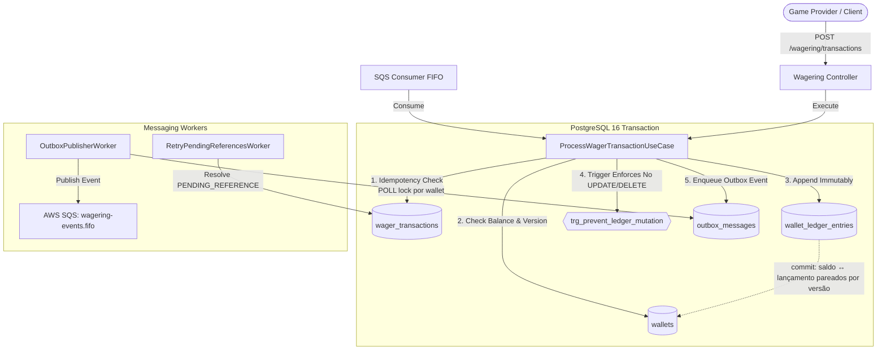

# Manual Breve do Desenvolvedor & Operador

O **Distributed Wagering Processor** é um motor transacional financeiro de alta precisão para processamento de apostas (iGaming). Ele processa débitos e créditos com precisão decimal arbitrária, garante imutabilidade contábil (ledger de lançamento único), previne saldo negativo concorrente e suporta resiliência a mensageria fora de ordem.

---

## 1. Como Subir e Executar

### 1.1 Pré-requisitos
- Docker & Docker Compose
- Bun `1.4.x` (testado com 1.4.2)

### 1.2 Comandos Essenciais
```bash
# 1. Iniciar infraestrutura local (PostgreSQL 16 + LocalStack 3)
docker compose up -d --wait postgres localstack

# 2. Executar migrações do banco
bun run migration:up

# 3. Executar suíte completa de testes (244 testes: 128 unit + 106 integração + 6 concorrência + 4 carga)
# Os scripts de teste definem ENABLE_BACKGROUND_POLL=false automaticamente
bun run typecheck    # tipos de produção, testes e scripts
bun run test:unit    # 128 testes — domínio puro (regras da seção 7) e contratos, sem I/O
bun run test:int     # 106 testes — PostgreSQL + LocalStack SQS reais
bun run test:e2e     # 6 testes  — paralelismo real multi-processo
bun run test:load    # 4 testes  — 50 BETs concorrentes, invariantes de saldo

# 4. Iniciar aplicação em modo desenvolvimento
# ENABLE_BACKGROUND_POLL=true é o padrão — o consumer SQS inicia automaticamente
bun run dev
```

### Variáveis de Ambiente Críticas

| Variável | Padrão | Descrição |
|---|---|---|
| `ENABLE_BACKGROUND_POLL` | `true` | Liga/desliga o consumer SQS em background. **Deve ser `true` em produção** (configurado no `docker-compose.yml`). Testes automatizados definem como `false` para evitar loops de polling. |
| `DATABASE_URL` | — | URL de conexão PostgreSQL 16. |
| `SQS_ENDPOINT` | — | Endpoint do SQS (LocalStack em dev: `http://localhost:4566`). |
| `DB_POOL_MAX` | `10` | Conexões por instância. Medido: 20 reduz o p99 do tráfego distribuído em ~10%, mas piora a hot wallet em ~40% (mais backends na fila do mesmo lock de linha). Some as instâncias e mantenha abaixo de `max_connections`. |
| `DB_LOCK_TIMEOUT_MS` | `5000ms` | Espera máxima pelo lock da wallet (parâmetro de sessão da conexão). Timeout vira retry e, esgotado, 503. |
| `LOG_LEVEL` | `info` | Nível do logger. O log de acesso HTTP registra só falhas (4xx `warn`, 5xx `error`); cada transação gera uma linha estruturada (`warn` em carga muito alta mantém só os desvios). |

Copie `.env.example` para `.env` e ajuste os valores para o seu ambiente.

---

## 2. Arquitetura em um Diagrama



---

## 3. Fluxo de Execução de uma Aposta (`BET`)

1. **Idempotency & Deduplicação**:
   - O cliente envia `Idempotency-Key` (obrigatório; sem ele, 400) e corpo JSON com `providerId` e `externalTransactionId`.
   - O processador calcula o hash canônico SHA-256 (`payload_hash`).
   - Se já existe registro no banco com a mesma chave:
     - Se o payload é idêntico: retorna resposta original gravada com saldo histórico (`balance_after`).
     - Se o payload difere: retorna HTTP 409 (`IdempotencyConflictError`).
2. **Lock da Wallet & Ledger**:
   - Trava a linha da wallet (`SELECT ... FOR UPDATE`): operações da mesma wallet entram em fila no PostgreSQL; wallets diferentes seguem em paralelo.
   - Confere titularidade (`playerId`) e moeda; aplica a regra do tipo (`settle` em `wager-rules.ts`): débito só com saldo suficiente.
   - Grava a entrada em `wallet_ledger_entries` com `balance_before`, `balance_after` e `wallet_version` (versão nova da wallet). No commit, o PostgreSQL confere que saldo e lançamento formam um par.
   - Lock timeout, deadlock ou conflito de versão geram até 6 tentativas com jitter; esgotadas, HTTP 503 com `Retry-After: 1`.
3. **Outbox Pattern**:
   - Cria evento de domínio `WalletBalanceChanged` persistido na tabela `outbox_messages` dentro da mesma transação ACID.
   - `OutboxPublisherWorker` publica em `wagering-events.fifo` no SQS em ordem por wallet: um publisher por wallet de cada vez (lock consultivo), parando na primeira mensagem com falha.

---

## 4. Conceitos-Chave e Glossário

| Termo | Definição |
| :--- | :--- |
| **Ledger de Lançamento Único** | Registro contábil onde toda mutação de saldo gera uma linha imutável com `balance_before` e `balance_after`. O saldo da carteira é matematicamente igual à soma algébrica do ledger. |
| **Lock por Linha (`FOR UPDATE`)** | Mecanismo de concorrência adotado: a linha da wallet é travada no início da transação, serializando operações da mesma wallet. A coluna `version` permanece como barreira adicional. |
| **Idempotency-Key** | Identificador único da intenção do cliente, prevenindo cobranças duplicadas em caso de retransmissão de rede. |
| **Transactional Outbox** | Padrão onde eventos são gravados na mesma transação atômica do banco de dados antes de serem despachados ao broker. |
| **PENDING_REFERENCE** | Estado de transação para reversões (`REFUND`/`ROLLBACK`) que chegaram à fila antes da aposta original (`BET`). |

---

## 5. Onde Mexer no Código

- **Regras de Negócio e Domínio Puro**:
  - `src/wallet/domain/`: Agregados `Wallet` e `WalletLedgerEntry`. Não adicionar dependências de framework aqui.
  - `src/wagering/domain/`: Agregado `WagerTransaction` e regras da seção 7 (`wager-rules.ts`: validação de referência, aplicação na wallet, titularidade).
  - `src/shared/domain/value-objects/`: Objeto de valor monetário `Money` (usando `Decimal.js`).
- **Casos de Uso**:
  - `src/wagering/application/use-cases/process-wager-transaction.use-case.ts`: Orquestração transacional de apostas.
  - `src/wallet/application/use-cases/reconcile-wallet.use-case.ts`: Auditoria e checagem matemática de saldos.
- **Persistência e Migrações**:
  - `src/migrations/`: Migrações versionadas MikroORM com scripts `up()` e `down()`.
